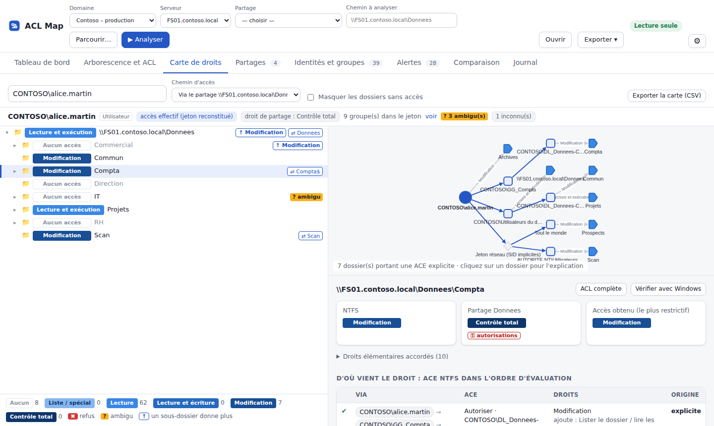
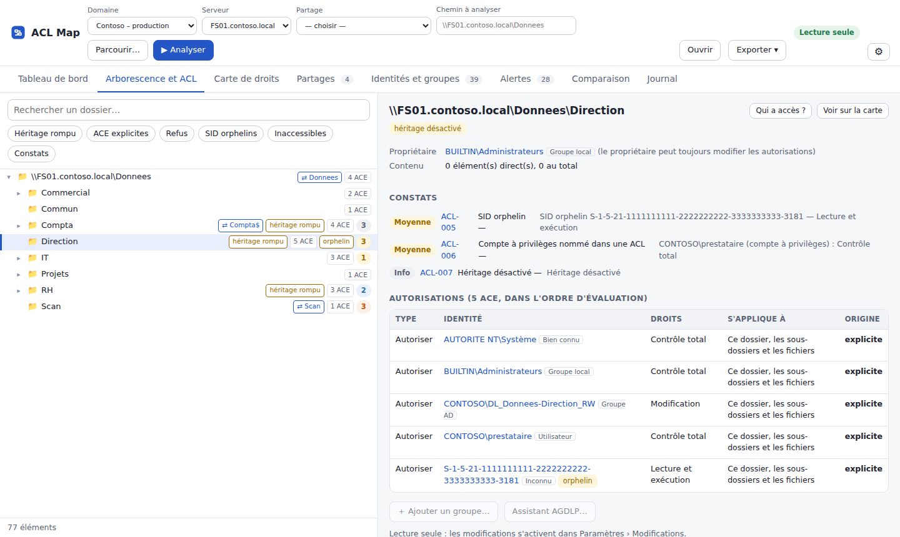
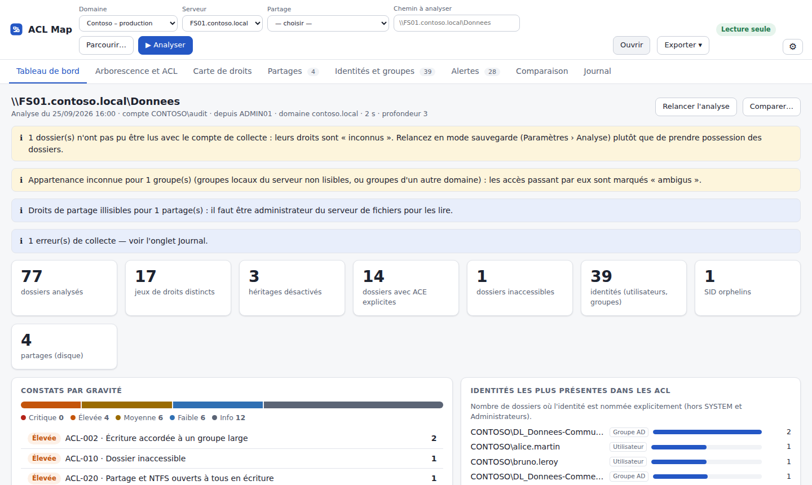
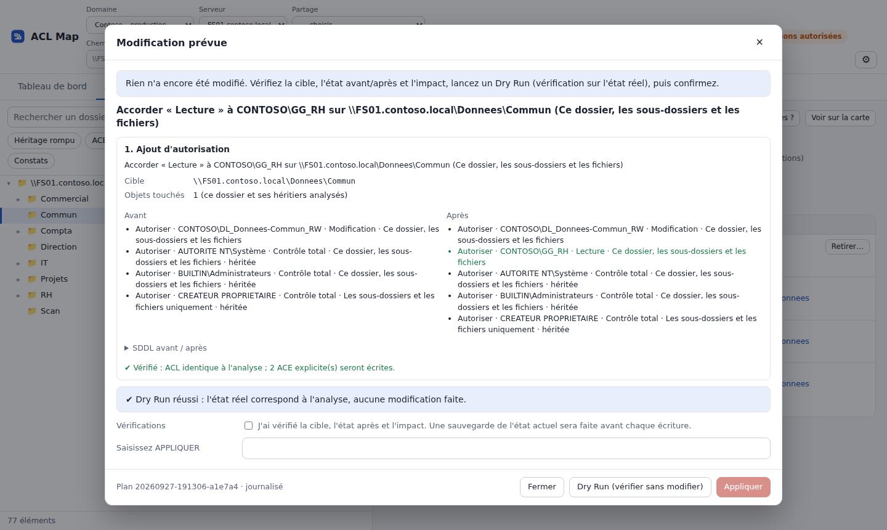

<p align="center">
  
</p>

<p align="center">
  <b>Cartographie des droits NTFS et des partages SMB : qui a accès à quoi, et pourquoi.</b><br>
  Outil Windows pour administrateurs système et sécurité — lecture seule par défaut.
</p>

<p align="center">
  
  
  
  
</p>

---

## Pourquoi

Sur un serveur de fichiers qui a vécu, répondre à « qui peut écrire dans ce dossier ? » demande d'ouvrir l'onglet Sécurité dossier par dossier, de développer des groupes imbriqués, de croiser avec les droits de partage… ACL Map fait ce travail pour toute l'arborescence et montre **l'origine de chaque droit** : utilisateur → groupe → groupe imbriqué → ACE → dossier.

## Fonctionnalités

- **Analyse d'un chemin** : `\\serveur\partage\dossier` ou chemin local, en parallèle, chemins longs, points de jonction signalés sans être suivis, dossiers inaccessibles jamais ignorés.
- **Carte de droits** : choisissez un utilisateur ou un groupe, l'arborescence se colore selon son **accès effectif** (NTFS seul, ou via un partage : le plus restrictif des deux l'emporte). Graphe d'origine et explication ACE par ACE.
- **Arborescence et ACL** : ACE explicites et héritées (avec le dossier d'origine), héritage rompu, refus, SID orphelins, « Qui a accès ? ».
- **Partages** : droits de partage, partages imbriqués, files d'impression exclues par défaut.
- **Identités et groupes** : membres directs et transitifs, groupes parents, groupes locaux du serveur.
- **Alertes** (règles ACL-001 à ACL-040) : écriture ouverte à « Tout le monde », contrôle total pour un non-administrateur, droit nominatif, compte à privilèges dans une ACL, SID orphelin, ACL non canonique, dossier inaccessible…
- **Comparaison** de deux analyses, **exports** HTML, CSV et JSON, **journal** des opérations.
- **Cas incertains signalés** : ACE conditionnelle, groupe aux membres illisibles, groupe d'un autre domaine → « ambigu », plutôt qu'une conclusion fausse. Vérification ponctuelle avec l'API Windows AuthZ.
- **Mode sauvegarde** (SeBackupPrivilege) : lire les dossiers verrouillés **sans en prendre possession**.

### Modifications contrôlées (désactivées par défaut)

Ajouter un groupe sur un dossier, retirer une ACE explicite, gérer les membres d'un groupe AD, créer un groupe, **assistant AGDLP** (`GG_Métier` → `DL_Partage-Dossier_RW/RO`).
Chaque opération : aperçu avant/après et nombre d'objets touchés → Dry Run sur l'état réel → confirmation explicite → refus si l'ACL a changé depuis l'analyse → sauvegarde → écriture → relecture de contrôle → journal. Restauration depuis l'interface.

## Captures

| Carte de droits | Arborescence et ACL |
|---|---|
|  |  |
| **Tableau de bord** | **Modification contrôlée** |
|  |  |

*Captures réalisées sur un jeu de démonstration fictif (`contoso.local`).*

## Installation

1. Prérequis : Windows 10/11 ou Server 2016+ x64, [runtime .NET 10 Desktop](https://dotnet.microsoft.com/download/dotnet/10.0) (`winget install Microsoft.DotNet.DesktopRuntime.10`), WebView2 (inclus dans Windows 10/11) pour l'interface.
2. Téléchargez `AclMap-<version>.msi` dans les [Releases](../../releases) et vérifiez son empreinte SHA-256.
3. Au premier lancement, **Quick Connect** vous guide : domaine, contrôleur, compte (session actuelle ou autre compte, type `runas /netonly`), serveurs de fichiers, test.

Déploiement silencieux : `msiexec /i AclMap-1.0.0.msi /qn` (options `DESKTOPSHORTCUT=0`, `SKIPDOTNETCHECK=1`).

Sur un serveur sans WebView2, le collecteur fonctionne seul en ligne de commande :

```powershell
& "C:\Program Files\ACL Map\AclMap.Collector.exe" scan \\FS01\Donnees --out D:\Audits --depth 12
```

Ports : 53, 88 et 389 vers le contrôleur de domaine ; 445 vers les serveurs de fichiers. Aucun module RSAT requis.

## Architecture

C# / .NET 10. Collecteur séparé (processus lancé avec les identifiants choisis), analyse hors ligne d'un instantané `.aclmap` (zip + SHA-256), interface WPF + WebView2.

```
src/
  AclMap.Models            modèles de l'instantané
  AclMap.Core              SID, descripteurs binaires, SDDL, niveaux de droits, archive .aclmap
  AclMap.ACL               jetons reconstitués, moteur d'accès effectif, règles d'audit
  AclMap.Services          carte de droits, explication, graphe, comparaison
  AclMap.Export            CSV, JSON, rapport HTML
  AclMap.Operations        plans d'écriture et exécution vérifiée
  AclMap.FileSystem        Win32 : lecture/écriture des ACL (sémantique de sauvegarde)
  AclMap.Shares            NetShareEnum / NetShareGetInfo
  AclMap.ActiveDirectory   LDAP signé/chiffré, groupes locaux, AuthZ
  AclMap.Collector         AclMap.Collector.exe
  AclMap.Hosting           contrôleur de l'application
  AclMap.UI                WPF + WebView2 (interface HTML/JS, Cytoscape.js)
tests/                     xUnit, jeu de laboratoire, tests Playwright de bout en bout
tools/AclMap.DevHost       l'interface dans un navigateur avec Windows simulé (développement, tests)
installer/                 MSI (wixl + msitools)
lab/                       scripts PowerShell : prérequis, arborescence d'essai piégée
```

Le moteur d'accès reproduit l'évaluation Windows (`MAXIMUM_ALLOWED`) : ordre des ACE, refus/autorisations, droits génériques, ACE « héritage seulement », droits implicites du propriétaire et `OWNER RIGHTS`, intersection avec les droits de partage.

## Construire

```bash
dotnet build AclMap.slnx
dotnet test tests/AclMap.Tests          # 81 tests
tests/ui/run-e2e.sh                     # 50 vérifications Playwright
installer/build-release.sh release      # MSI (Linux/WSL : paquets wixl et msitools)
```

## Suite AD Tools

ACL Map fait partie d'une suite d'outils d'audit Active Directory avec **GPO Map** (cartographie des stratégies de groupe) et **Tier Map** (modèle de tiering).

## Avertissement

À utiliser uniquement sur des environnements que vous êtes autorisé à administrer ou à auditer. Voir [SECURITY.md](SECURITY.md). Licence [MIT](LICENSE).
